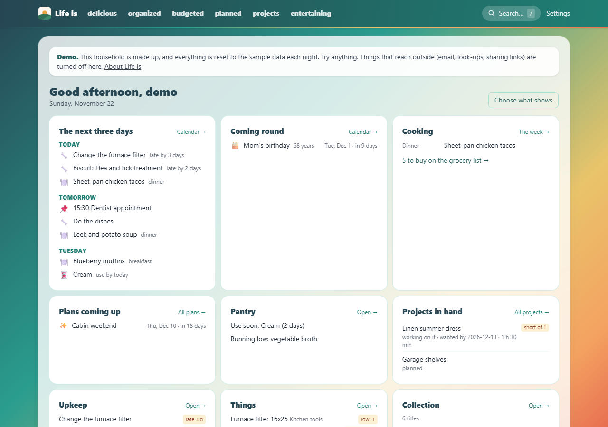
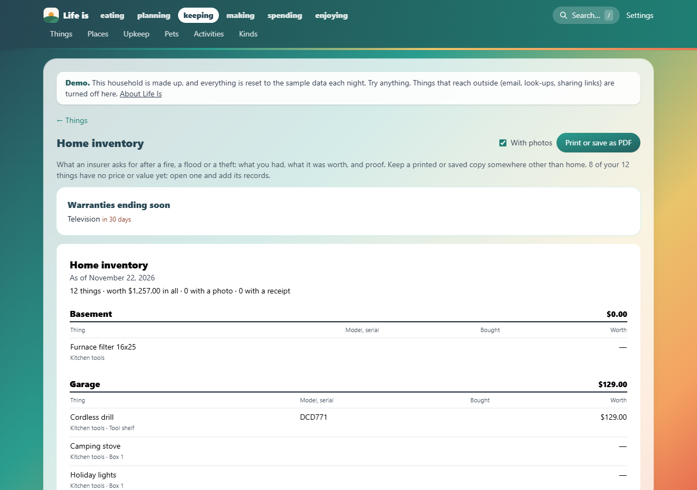
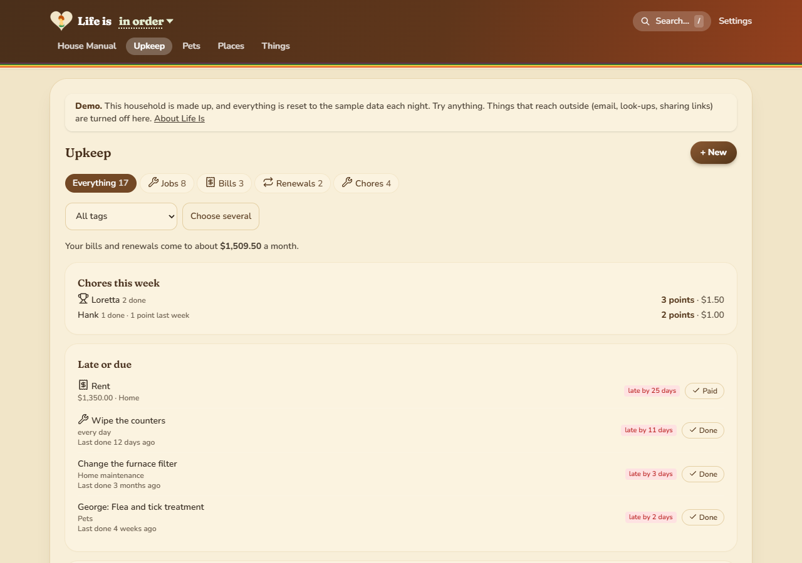
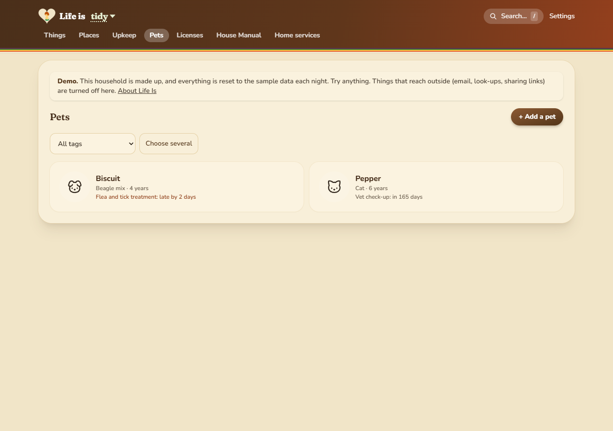

# Life Is

Life is chaotic, disorganized and overwhelming sometimes. Life Is helps put it back on track: a planner for everyday
life that runs on your own computer, with your records kept there, encrypted.

So far, in five sections: food (recipes, the week, groceries, the pantry, prices), home (the calendar, things and places,
upkeep, routines, licenses, pets, a House Manual, tags, mail), money (a monthly budget, a year view, goals, income and
bills), projects and plans (with holidays and activities), and media (books, films, music and games).

## The kitchen

- **Recipes kept exactly as you wrote them.** Every ingredient line and every step is stored word for word, with
  your section headings ("For the sauce"). Nothing shortens, summarizes or rewrites a recipe. When you paste or
  import one, the original is kept beside it too.
- **One list of ingredients behind everything.** "Flour" in a recipe, in the pantry and on the grocery list is the
  same thing, so the three stay connected.
- **The week's meals.** Plan breakfast, lunch, dinner and snacks, with a recipe or just a note ("leftovers").
  Change the servings and the amounts follow.
- **A grocery list that knows your pantry.** It's what the week's meals need, for the servings you planned, minus
  what you already have. Grams and pounds add up, and so do cups and spoons; weight and volume never get mixed
  (a cup of flour and a cup of honey weigh different amounts), so those are listed in full and marked.
- **The pantry.** What you have, how much, where (fridge, freezer, cupboard), when to use it by, and when it's
  running low. Checking something off the grocery list puts it in the pantry; marking a meal as cooked takes out
  what it used.
- **What it costs, as you shop.** Type the price as each thing goes in the buggy and the total keeps up, in
  sight while the list scrolls. Next time the list says what each thing cost last time and where, guesses the trip
  before you start, and keeps a price history for each ingredient. Check something off without a price and last
  time's stands in, marked as a guess.
- **Prices over time.** A page of what each thing has cost: its latest price, how it changed, where it was cheapest,
  and a chart. Things always bought by the same measure are compared for one of it, so 2 lb and 5 lb sit side by
  side. Spending is totalled by the month.
- **Stores and sizes.** Your stores are a list to pick from, and each price keeps the size you bought: the amount on
  the list, or the size on the package (a 30 oz can, a 12 oz bag). So a thing's price is shown for one ounce, pound
  or each, whatever size it came in, and set side by side for each store, cheapest first.
- **A usual store and a usual size for each thing.** "Coffee: Costco, 3 lb." The list can be laid out by store, with the
  one you're standing in first; the usual size shows on a line that gives no amount, and is what a price is taken
  to be for unless you type another.
- **Scan it in the store.** Point the camera at a package. The first time, say which thing on the list it is; after
  that a scan finds its line, shows last time's price, and puts it in the buggy with what you type.
- **Coupons.** Money or a percentage off, for one thing or the whole trip, perhaps at one store and until a day. The
  list flags the line a coupon is for; using it takes it off the total.
- **A recipe knows what it's cooked in.** Pans, dishes and tools from the things you keep (the cast iron skillet,
  the 8x8 baking dishes), or just by name. The week then tells you when one meal needs more of something than you
  own: "Thursday dinner: 4 × 8x8 baking dish, and you have 2."
- **Your recipes, yours to take.** Bring them in by pasting text or recipe JSON (from the Nextcloud Cookbook app or
  a recipe website). Take them all out as Nextcloud Cookbook folders, ready to drop into your Nextcloud.

## The front page

What today holds and what wants attention, gathered from every section you use: the next three days, today's
meals and any pan you're short of, what's running low or about to go off, the projects in hand, what's lent out.
Also the birthdays and anniversaries coming up, and the week in numbers. Each card leads to its page, and you
choose which cards show.

## Outside services, only if you turn them on

Life Is works without reaching outside your computer. The few things that do are listed in one place in Settings,
each off until you turn it on, each saying exactly what it sends:

- **Weather on the front page**, from [Open-Meteo](https://open-meteo.com) (no account, no key). It is sent the
  town you look up, then that place's position rounded to about half a mile. Turning it off forgets the place.
- **Email, to read and answer your inbox**, with any provider that lets mail programs in (IMAP and SMTP): Gmail,
  iCloud, Fastmail, Yahoo, your own server, Proton through its Bridge. Life Is signs in from your computer with
  the password you give (for most providers an "app password"), stored locked. No message is ever kept: the inbox
  is read when you look. Opening a message doesn't mark it read. The line is always encrypted, and the account is
  only saved if signing in works.
- **Looking a grocery up when you scan it**, from [Open Food Facts](https://world.openfoodfacts.org) (no account, no
  key). It is sent the number under the barcode and nothing else. Scanning works without it.
- **Looking a book up when you scan it**, from [Open Library](https://openlibrary.org) (no account, no key). It is
  sent the number under the book's barcode and nothing else; what comes back is yours to check before saving.
- **Photos from your own Immich**, linked to plans and memories without copying them. Life Is asks your Immich
  which photos were taken on a plan's days and fetches the ones shown; a plan keeps only which photo it is. The
  key needs two permissions, `asset.read` and `asset.view`, and nothing in Immich is changed.
- **Your Jellyfin or Emby**, read-only, at the address you give.
- **More**: music and game barcodes, car recall checks, films from TMDB, morning reminders by ntfy, browser push or
  email, an AI assistant, and bank reading. Settings → Connections lists every one, and `docs/privacy.md` has the
  full table.

## It asks what you need

The first time you sign in, Life Is asks what life needs looking after: cooking, what you own, projects, sewing,
the garden. It shows the parts that fit and adds ready-made kinds of things to start from. Change the answer any
time in Settings; unchecking something only puts it out of sight.

## The things you keep

- **Your own kinds of things.** Fabric, yarn, tools, seeds, board games: a kind is whatever you say it is, with
  the fields you care about (a fabric's width, a seed packet's sow-by date). Start from a ready-made set (sewing,
  yarn crafts (knitting, crochet, macrame), woodworking, gardening, around the house, cookware with cast iron, clothes and shoes with their sizes,
  bedding by bed size) and change it, or make your own
  from nothing.
- **Where everything is.** A room, a shelf in it, a bin on the shelf, as far down as helps you find things.
- **A sticker for every shelf and bin.** Print a sheet of QR stickers for your places. Point a phone at one and
  see what's inside: your things and whatever from your collection is kept there. Only someone signed in to your
  Life Is sees anything, and the stickers stay good if its address changes.
- **How much is free.** What you have, less what your projects have set aside.

## Projects

- **Anything made or done over more than a day**: a dress, a sweater, a bookshelf, the spring planting.
- **A list of what it uses**, drawn from your things. An amount ("3 yd of the blue linen") is set aside, so two
  projects can't count on the same cloth, and each says what it's short of. Using it, or finishing, takes it
  out of what you keep.
- **The days you worked on it**, how long, and what you watched or listened to.

## Plans, and the memories they become

- **Anything with a day and things that belong to it**: a vacation with its menu, dishes and films, or one afternoon's
  sewing. Make it ahead, or write it down afterward.
- **It points at what you already have**: recipes, things (with how many are needed, so it says what you're short
  of), titles from the collection, a project, and a checklist of its own. Nothing is copied.
- **Its food goes on the week.** Say which day and meal a plan's recipe is for (or a day before, for what's made
  ahead) and it's on the week's meals, so the grocery list and the pans that meal needs follow. Move the plan and
  its meals move too; a meal already cooked stays where it happened.
- **Once its days have come, it remembers**: what was cooked, worked on, watched and heard on those days is gathered
  in, with your own words about how it went and your photos. A photo picked from your phone is made smaller and
  kept with the plan; one from your Immich library is only linked, and stays there.
- **Look back, and do it again**: past plans stay, by year. "Do it again" starts next year's from last year's.

- **Front page, plan cost, and just this store.** The front page gains cards for plans coming up and coupons about to
  run out (each only once you have one). A plan with recipes says roughly what its food will cost, going by the last
  price of each ingredient. The grocery list, laid out by store, can show just the store you're in.

- **Bring a recipe in**, three ways (Recipes → "Import one"). From a website: paste the address and Life Is reads the
  recipe the page publishes for search engines, without the story around it. From a photo or a book: the words are read
  off the picture on your own device (the photo is sent nowhere and not kept). Or paste the text. Each gives a draft
  to look over; nothing is saved until you press Save, and what was read is kept alongside.

## The calendar

- **One place to see what's on each day.** Your own dates (a day or several, with a time if it has one), with
  the week's meals, the time on projects and the days they're wanted by, what's about to go off in the pantry,
  and what you watched, read or heard. Each of those leads back to the page it lives on.
- **Birthdays and anniversaries.** Check "Every year" and give the day it first happened: it shows each year, counting
  the years.
- **On your phone's calendar.** Settings → Calendars → "Your phone's calendar" makes a private link that Apple Calendar (or
  any calendar app that follows a link) reads, so plans, meals and dates show there too. Off until you make one;
  you check what it carries; it only shows and can't change anything; a new link stops the old one working. Anyone
  holding the link can read what's checked, so it is long, random, and yours to replace.
- **Other calendars, on yours.** Settings → Calendars → "Other calendars" follows any calendar that has a link
  (a work calendar, a shared family one). Followed "busy only" by default: just the times, under a name you give it.
  What each thing is called, where it is and its notes are dropped as it's read and never stored. The link is kept
  locked, read about once an hour, and a followed calendar is never passed on through your own phone link.

## Films, shows, music, books and games

- **A title, and your copies of it.** Alien on VHS and on Blu-ray is one film with two copies, each in its own
  place, each lent out or at home. A format is any word you like: Betamax, 8-track, vinyl, paperback.
- **What you'd like to have.** A title with no copy can be marked as wanted.
- **Scan a barcode with the camera.** Point your phone or tablet at the back of the case: if you have it, you're
  taken to it; if not, add it with the barcode kept on the copy. The picture is read on the device and never sent
  anywhere. Typing the number, or a handheld scanner, works too.
- **Your Jellyfin or Emby library, beside the discs.** Connect the server with its address and a key, and its
  films, shows, albums and books come into the collection, with their covers, kept in step as often as you choose.
  A film you also own on disc is one title with both copies. Life Is only reads from the server.
- **What you've watched, read and heard**, by day. Add a film to the time on a project and "watched Alien while
  sewing" shows from the project, from the film, and on the calendar.

## Run it yourself

Try it first, no install: [the demo](https://demo.lifeis.living) (anyone can change things there, and it resets).

You need [Docker Desktop](https://www.docker.com/products/docker-desktop/) (Windows or Mac) or Docker (Linux,
a Synology or other home server). The image runs on Intel and ARM computers. Save this as `docker-compose.yml`
in a folder of its own:

```yaml
services:
  lifeis:
    image: ghcr.io/lconthehub/lifeis:latest
    ports: ["127.0.0.1:8020:8008"]
    volumes: [lifeis_data:/data, lifeis_keys:/keys]
    restart: unless-stopped
volumes:
  lifeis_data:
  lifeis_keys:
```

Then, in that folder:

```bash
docker compose up -d
```

Open <http://localhost:8020> and make your account. It's only reachable from this computer; to use it from your
phone, use [Tailscale](https://tailscale.com) and add it to your home screen.

Your records are kept by Docker, encrypted, with the key kept apart from them. **Never run
`docker compose down -v`**: the `-v` deletes them. To update: `docker compose pull && docker compose up -d`.

Or build it from the source instead:

```bash
git clone https://github.com/LConthehub/lifeis.git
cd lifeis
docker compose up -d --build
```

| The front page | Things and where they are | Upkeep | Pets |
| --- | --- | --- | --- |
|  |  |  |  |

## For developers

- **On the device, with no server** (in progress, for the phone apps): everything a signed-in person does is written as
  handlers that know nothing of how a request arrived (`server/src/everydayRoutes.ts`). The server puts them behind its
  sign-in; the on-device build (`frontend/src/device`, `npx vite build --config vite.device.config.js`) hands the pages'
  requests straight to them, with the database inside the app. On a phone the database is SQLite encrypted with
  SQLCipher through Capacitor, opened with a key the phone's keystore holds (`frontend/src/device/nativeDatabase.js`).
  Only a browser build, for trying the on-device app, uses the unencrypted in-page stand-in
  (`frontend/src/device/database.js`), and it is never what ships.
- `core/`: the kitchen, in TypeScript, written so the same code runs on the server, in the browser and inside a
  phone app. `kitchen.ts` is the kitchen, `units.ts` reads amounts and converts units, `recipeText.ts` reads
  and writes recipes, `inventory.ts` is the things you keep, `projects.ts` the projects, `calendar.ts` the calendar, `media.ts` the
  collection, `life.ts` what each person asked for, `migrations.ts` the database's shape (a
  shipped migration is never edited). It reaches
  the database only through the small `Db` interface in `db.ts`, which each place Life Is runs supplies.
- `server/`: the program, on Node 24 with no build step: sign-in, the web addresses the pages call, and an
  SQLCipher-encrypted SQLite database. It installs the encrypted database engine and three mail libraries (imapflow, nodemailer, mailparser). It
  reaches out only to the services a person turns on or uses. Each one is listed under "Connections" in Settings and in
  `docs/privacy.md`, and each service's `sends` sentence in `core/src` says what it sends. Keys are stored locked
  (`vault.ts`).
- `frontend/`: the pages. React, Vite and Tailwind. The small icons are from Lucide (ISC license; the notice is in
  `docs/site-src/lucide-ISC.txt`), used by name through `frontend/src/components/Icon.jsx`.
- `backend/`: the first version of the program, in Python. Docker no longer runs it. It is kept for now as the
  reference `core/` is checked against: `python core/tests/golden.py` writes its answers down, and the tests
  hold the TypeScript to them. The database file, its encryption and the passwords are the same in both.
- Tests: `docker compose -p lifeis-dev -f docker-compose.dev.yml run --rm tests`, or `npm test` in `core/` and
  in `server/` (after `npm install` in each).
- Working on it: `docker compose -p lifeis-dev -f docker-compose.dev.yml up` (the program on port 8020, the
  pages with live reload on port 5180). Stop the Life Is you use first: it has the same port.

Life Is shares its sign-in and encryption code with its sister project, Sworkr. The plan is to move that shared
part into one package both use.
